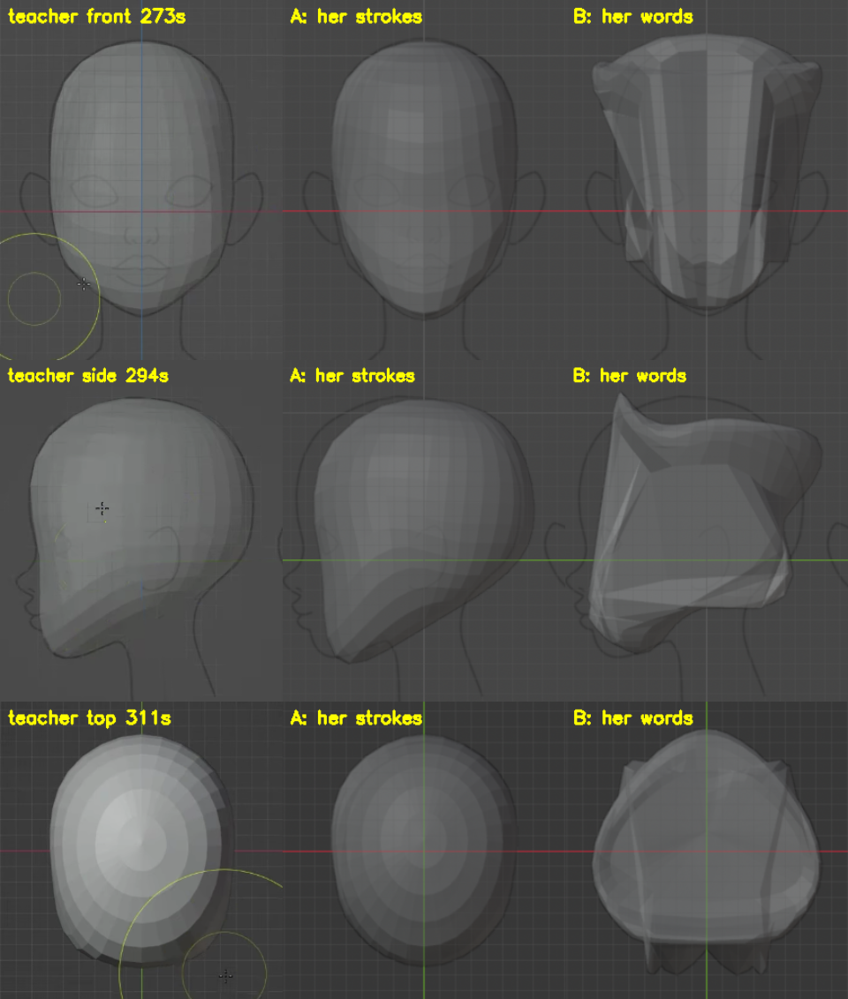

# Blender 5.3 by mouse and keyboard alone

The goal was for an agent to do everything in Armin 5D's "Blender 5.3 Is the Biggest Update in Years" (13 minutes,
about 60 features across 35 areas) through this server's mouse, keyboard and screen tools, with no Blender MCP and no
Python. Blender draws its own interface, so the accessibility tree is empty and every action is a key, a pointer
gesture or OCR. Running the gestures the video needs against Blender 5.3.0 on macOS 26.2 found four defects that broke
ordinary Blender use and three gestures the server could not express. All are fixed on `fix/blender-direct-input`;
the fixes are pinned by 16 unit tests and were confirmed in Blender by reading the result back from Blender's own data.

## How it was checked

The video was transcribed on device (Speech framework `SpeechTranscriber`) and sampled into contact sheets; the
transcript is not kept here. Blender was started with a test fixture (`--python`) that writes the scene state to a
JSON file four times a second and runs set-up snippets: it is how the tester read results, never part of the route
under test. Raw CGEvent probes (Swift) settled what Blender reads before any server code changed. Then each feature
was driven through the server in-process (`createComputerUseServer` + `connectInProcess`) with OCR to find controls,
and the fixture said whether it happened.

## Defects found

| # | Defect | Where | How it was confirmed |
|---|---|---|---|
| 1 | macOS `key` set modifier flags on the key event and never pressed the modifier key. Blender tracks modifiers from flagsChanged events, so `key "shift+a"` arrived as `A` with shift false: every modified Blender shortcut was broken. | `native/src/keyboard.rs` `key_press_impl`, now `ModifierKeys` at `:530` and the press at `:658` | An in-Blender modal event logger recorded `["A","PRESS",…,shift false]`; after the fix `LEFT_SHIFT PRESS` then `A PRESS` with shift true, and the Add menu opened |
| 2 | macOS pointer gestures with `modifiers` did the same, so `mouse_drag {button: "middle", modifiers: ["shift"]}` orbited instead of panning (AGENTS.md documented it as panning). | `native/src/mouse.rs` `post_button_event` `:607`, modifier keys at `:650` | View rotation changed and location did not; after the fix location moved (−0.02 → −1.93) and rotation stayed |
| 3 | `type` posted Unicode text 20 characters per key event; Blender keeps one character per event, so "Relax Edge Loops" in F3 search arrived as "R". | `src/session/input-handlers.ts` `ONE_CHARACTER_PER_KEY_APPS` `:41`, `#readsOneCharacterPerKey` `:916` | Screenshot of the search field holding "R"; with key events `MESH_OT_relax_edge_loops` ran |
| 4 | The capture helper's window capture returned Blender's 1280×922 main window letterboxed into the 1060×632 frame of its file browser window, while the reply still mapped `screen = origin + image`. A double-click computed from OCR on that window hit the browser's new-folder button and created two empty folders in the home directory (removed straight away; both empty, created at the second of the click). | `libexec/macos-agent-helper.swift` `captureWindow`, fallback at `:147`, `isLetterboxed` `:166` | Side-by-side captures: window filter gave the main window, `SCContentFilter(display:including:)` with `sourceRect` gave the browser. Edge-midpoint alpha was 0 on the bad capture and 255 on good ones; after the fix OCR on the browser read its own path field at the right place |

## Gestures that could not be expressed

| Gesture | Needed for | Added |
|---|---|---|
| A click with a modifier | Alt+click edge loops (loop tools), shift-extend | `click {modifiers}`; macOS `mouseClickModified` (`native/src/mouse.rs:727`), elsewhere press/release with the real keys |
| A key held through a click or drag | Sequencer blade while C is held; annotation while D is held | `hold_keys` on `click` and `mouse_drag` (`#withHeldKeys`, `input-handlers.ts:395`) |
| A key pressed mid-drag | Sequencer R/S/V while a strip is dragged | `mouse_drag {key_presses: [{at, key}]}` (`#dragKeyPresses` `:947`) |
| Pen pressure | Grease Pencil width, sculpt strength, the pressure curves in the video | macOS `mouse_drag {pressure}` (`mousePenEvent`, `native/src/mouse.rs:667`; `pressureAt`, `input-handlers.ts:50`) |
| The numeric keypad | Blender's views (1/3/7, 0 camera, decimal to frame) | `numpad0`…`numpad_equals` on all three platforms (`native/src/keyboard.rs:108`, `:509`, `:1159`; `src/session/keys.ts`) |
| Modifiers on the wheel | Ctrl+wheel and shift+wheel in Blender | `scroll {modifiers}`; macOS `mouseScrollModified` (`native/src/mouse.rs:736`) |

Pen pressure has one twist. Blender keeps the last tablet pressure until the pen leaves proximity, and no synthetic
proximity event reached it: a standalone `kCGEventTabletProximity` and a mouse event with the proximity subtype, each at
the HID and session taps, all left the state alone. Ending the stroke with a release at pressure 1.0 parks it at full
pressure, which is what a plain mouse gives. Measured: Grease Pencil radius 0.0029 → 0.03 → 0.0029 for `[0.1, 1, 0.1]`
and a constant 0.03 for the mouse stroke after it; a sculpt stroke moved the mesh 0.375 at pressure 0.15, 2.437 at 1.0,
and 2.437 again for a mouse stroke afterwards.

Not a gap: number-field drags work without motion deltas. A drag on Location X moved the cube 0.67 with and without
`kCGMouseEventDeltaX/Y` set, so the window server derives them.

## Live results

Each row was driven through the server only and read back from Blender.

| Area | What ran | Result |
|---|---|---|
| Modeling | Shift+A > Mesh > Quad Sphere by OCR; redo panel Method → Even Angle, Segments typed 6; outliner click + Delete; numpad1, numpad decimal, Tab; alt+click equator loop; F3 Relax Edge Loops; sidebar Dimensions X typed 3 m; snap popover → Origin | all pass (24 of 218 vertices, one z level; width 3.000; `snap_elements {'ORIGIN'}`) |
| Shading | New material; Shift+A "Light Info"; socket drag Color → Base Color; Transmission Dispersion Scale typed 1; Comment node, two lines of markdown; Ctrl+X cut; Cmd+Z | all pass |
| Properties | Tabs found by tooltip; Compositor & Effects > Add Scene Effect > "Bloom"; camera Type Panoramic, Panorama Type Mirror Ball (EEVEE) | all pass |
| Outliner and sidebars | Drag Light above Camera; Shift+H, Alt+H; Ctrl+F over the sidebar and a filter | all pass |
| Grease Pencil | Pen strokes with pressure; D-drag annotation | pass |
| Sequencer | Drag C1 onto C2 pressing V (overwrite: C2 gone, C1 61–91); Cmd+Z; pressing R (ripple: C2, C3 shifted 30); C-held click (C0 cut at frame 16) | all pass |
| Sculpt | Strokes at 0.15, 1.0 and mouse | pass |
| Pies | Ctrl+Tab → Object Mode; Z → Wireframe, Z → Solid | pass |
| Rendering | F12, `wait_for_window` "Render", `wait_for_stable`, OCR "Frame:1 \| Time:00:03.02", Escape | pass |
| File browser | File > Import > Stanford PLY; directory typed (128 characters, pasted); double-click the file | pass after defect 4 |

## Proof run: every remaining feature

The table above covered the gestures. A second run on 2026-11-21 took every feature of the video that was still only
"the same gestures" and drove it the same way: the server alone for input, OCR to find controls, and the fixture to
read the result back. 98 records went to a ledger; a feature counts once its last record passed on Blender's own data.
`skills/blender-direct` has the full table (64 rows proven); the evidence by area:

| Area | Proven, with the read-back |
|---|---|
| Modeling | Curve Edge Loops (11 rows lifted into an arc peaking at 0.5); Fit Edge Loops to Annotation |
| Shading | Light Accumulation with Light Info, Light Evaluation and Shadow Raycast, every link valid; Boolean Math, Integer Math, Switch, Index Switch, String; Shift+X dissolve (`NODE_OT_delete_reconnect`); Glass anisotropy 0.6; Sky Sun Disk off |
| Compositor | Chromatic Aberration, Film Grain, Vignette as scene effects; a new tree holds Group Input and Output; Kuwahara; Integer Math, Boolean Math, Index Switch |
| Rendering | A Cycles rendered viewport read "Rendering Paused" during F12; the greyed-out ray-traced shadows control explains itself in its tooltip |
| Grease Pencil | Stroke menu in Draw mode; lasso selects 14 points of one stroke and `g x 1` moves only it; one fill across two regions; gradient fill with a ColorRamp; Carver splits a stroke (8 points → 5 + 5); Flip View (`use_view_flip_x` on); Reset Roll (roll −0.26 → 0) |
| Sequencer | S after V keeps C2 where V alone overwrote it; ripple delete closed the gap; blade preview line with a frame readout; box blade cut every strip in the box; text strip thumbnail; colour dragged into the timeline made a colour strip; Shuffle and unclamped handles by default; OTIO export (34 KB) and import (a new scene with the 6 strips) |
| Geometry Nodes | Rasterize Points, Grid Solve Poisson, Construct Curves, Combine List and the others by search; Curve to Mesh Miter Scale; Realize Instances Preserve Normals |
| Weight paint | Add Weight is the default brush and Paint is now Set Weight; multipaint, auto-normalize and mirror vertex groups on in a new file; Topology automasking toggled from the Alt+A pie |
| Sculpt | Hardness, Auto-Smooth and Spacing pressure toggles, the auto-smooth curve edited by a drag (a new point at 0.5, 0.781); Transform Only: Pivot moved the gizmo while the vertex sum stayed 163.21536; hair Cut brush 92 curves → 80; multires colour attributes drawn in Sculpt Mode (mean face colour 141, 30, 27, not black) |
| Animation | World Space copy and paste: the prop matched the bone at five frames; Ctrl+R converted Euler keys to quaternions, then baked; Paste Pose factor 1, 0.5 and 0.25 gave 4, 2 and 1; Fix to Camera held the object at (0.593, 0.653) in frame across five frames; wrap navigation went 48 → 1 → 48; scrubbing during playback left it playing |
| Splats and pipeline | A splat PLY imported as a point cloud; Type switched both ways; rotated −90° on X; Emission swapped for a Diffuse BSDF; glTF (105 KB, 3 meshes, 2 materials); USD export, and a collection importer that imports the USD and refreshes it with the object count unchanged; Alembic with `AbcGeom_SubD_v1` and the levels stored, imported back as a Subdivision modifier at 2/2 |
| Asset libraries | With the owner's go-ahead (2026-11-22): online access turned on with the Allow Online Access button; Poly Haven Lite found in Get Extensions as an Asset Library (`asset-library-poly-haven-v1.0.0.zip`, 393 bytes, CC0) and installed; the Asset Browser listed its HDRIs, Models, Textures and Demo Scenes; the Pocket Watch downloaded (11.2 MB `.blend`) on a click and dragged into the viewport as a collection instance with six meshes, two materials and five textures |
| Projects and outliner | File > Project > New wrote `.blender_project/project.toml`; ACES 2.0 Studio picked in Project Settings; a new collection went to the Scene Collection with another active; a parent dragged into a collection took its child; the Users column set a fake user (users 1 → 2); "猴子モデル원숭이" typed into a name field |

Not possible on this route or machine: the DLSS viewport denoiser (needs an NVIDIA RTX GPU; Denoiser lists only
Automatic and OpenImageDenoise here), the DLSS Render add-on (paid, third party), Vulkan as the default (Windows and
Linux only), and Workbench hardware ray-traced shadows (greyed out: its tooltip says it needs Vulkan).

Not proven:

- **Dragging text from another app into the sequencer.** Two synthetic drags of selected TextEdit text onto the
  timeline started no drag session and made no strip. Whether a synthetic drag between apps can start an `NSDragging`
  session at all is the open question; a colour dragged inside Blender worked.
- **Stable saving.** Saving an unchanged file twice, and opening and saving it, gave different hashes each time (about
  22 bytes apart). Three headless open-and-save runs (`blender -b`, no interface) differed too, so it is Blender on
  this file, not the route.

Not tried: private libraries with a token (the Add Remote Repository dialog has "Requires Access Token", but there was
no private repository, and a token is for its owner to type); SPZ, USD and glTF splat files (no samples); Grease
Pencil frame durations from old files, and scene and mask strip thumbnails (need old files and media); input-method
composition for Chinese, Japanese and Korean (the text itself was typed); and the performance claims (cached playback,
smoother scrubbing), which want a benchmark rather than a pass or fail.

### Side effects of the proof run

- One accidental Apply Object Transform from a mis-aimed menu click; the transforms were identity, so nothing changed.
- TextEdit was opened for the drag test, its documents discarded and the app quit (it was not running before).
- **Blender's user config was written.** `--factory-startup` does not stop Blender saving recent files: the test
  sessions replaced `~/Library/Application Support/Blender/5.3/config/recent-files.txt`, `bookmarks.txt` and
  `recents.toml` with scratchpad paths. Those entries were removed afterwards, but whatever the files held before is
  gone. `userpref.blend` was not touched. The asset library run started Blender with `BLENDER_USER_RESOURCES` in the
  scratchpad, and a file listing of the config folder before and after matched.
- The asset library run still wrote to `~/Library/Caches/Blender/remote-assets`, which `BLENDER_USER_RESOURCES` does not
  cover: a new Poly Haven folder (12 MB with the Pocket Watch, removed afterwards) and a metadata refresh of the
  existing Online Essentials cache (8 files).

## Following a sculpting tutorial: maoly_studio, "How to sculpt stylized face"

The second test followed a 35-minute YouTube sculpting tutorial (Blender 4.0.2) step by step: the teacher's own keys,
read from her Screencast Keys overlay by OCR at 2 fps (1,586 changes), her clicks read from the frames, and her
narration from the transcript. Her set-up was reproduced exactly: an empty scene, her three-viewport layout, Emulate 3
Button Mouse (her pen navigation), the reference at opacity 0.031, her moves of both references (G Y 4.77 m, G X,
Shift+D, R -90 in top view), the UV sphere at scale 0.64 and height 0.238 (hers 0.643 and 0.233), X-ray, Sculpt Mode,
Grab and symmetry X.

Her pen strokes are not in the overlay, so the blockout (3:36 to 5:11) was done twice from the same sphere:

- **A, her strokes replayed.** Blender hides the brush ellipse while a stroke drags and shows only the crosshair, so
  her pen is down when the crosshair shows without the ellipse. Mapped from her view to this one in world units, with
  her brush sizes, 45 strokes give her result in front, side and top (crown 1.08, chin -0.69; hers about 1.0-1.1 and
  -0.68). Calibration decided it: at 143.6 px/m (3% off) her top strokes pressed just outside the sphere and moved
  nothing; at 139.1 (measured from the sphere) they lifted the crown 0.879 to 1.08.
- **B, her words ("make it follow the reference") with strokes placed by outline matching.** The outline matched the
  drawing (overlap 0.95 front, 0.89 side) but the mesh folded: a big Grab brush pulling only the silhouette of a
  482-vertex sphere makes flaps she never makes. Following her words takes judgement of the surface, not only the
  outline.

What it changed in the server (7.8.1):

| Gap | Change |
|---|---|
| The status card took clicks under it: 0 of 12 on Blender's X-ray button landed | Pointer input moves the card to a clear corner first; 12 of 12, 78-100 ms per click (macOS; Windows written, not yet run) |
| Captures said nothing about the pointer | Every screenshot and zoom reports it; `include_pointer` draws the real cursor (Blender's crosshair) |
| A key could not stay held across calls | `hold_key` down / up / release, released after 60 s, on Pause, Stop, take-over, session end and exit; Shift held across calls smoothed in Sculpt Mode (0.053 m of movement against 0.165 m unheld) |
| Setting a brush size needed the current size | Not a server gap: F takes a typed value (`f`, `150`, Return gave 153.7 px across, the line included) |

## Open items

1. **Scroll direction.** `scroll {direction: "up"}` posts a negative wheel delta, which Blender reads as
   WHEELDOWNMOUSE (it zoomed out). It has been so since 7.1 and no test pins the direction. Check it against a browser
   before deciding whether "up" means what a person expects.
2. **`mouse_drag` is not in the default `desktop` profile.** Blender needs it for nearly everything; the skill says to
   use `full`. Moving it to `desktop` would take the list to about 47.4k of its 48,000-byte budget.
3. **Windows and Linux are untested here.** The keypad maps there are written from the VK and evdev tables; pen
   pressure is refused on both.
4. ~~`hold_keys` with a modifier name on macOS presses the key but does not flag the pointer events.~~ Fixed: a held
   modifier (`hold_keys` or `hold_key down`) now marks every pointer event.
5. A fresh server seeds its user-active clock from `HIDIdleTime`, which this server's own posted events reset, so a
   server started within 4 s of another server's input refuses with `user_active`. Seen in the test harness, which
   started a server per step.
6. A click and a press at the same spot within about 0.35 s is a double-click to Blender: a strip drag started right
   after a click on the strip did nothing. Documented in the skill; the server does not space them.
7. OCR boxes are in window points and the reply carries `screen_origin` once. Most mis-aimed clicks in the proof run
   came from forgetting to add it (about 30 points too high on Blender's main window). `click_text` avoids it; the
   skill now names it as the first thing to check when a click misses. Captures now also report the pointer in image
   pixels, which shows the offset at a glance.
8. The first click into Blender while another app is in front only activates it. Menu clicks were lost this way until
   the harness's menu helper retried once. `click` could say so in its `effect` when the frontmost app changed.
9. A native addon older than the TypeScript layer gives a key error that contradicts itself: the asset library run
   started the harness without `COMPUTER_USE_NATIVE_PATH`, loaded the 7.8.0 addon from `node_modules`, and `key
   "numpad_decimal"` failed with "Unknown key in combo: numpad_decimal … Valid keys: … numpad_decimal …"
   (`explainNativeKeyError`, `src/session/keys.ts:146`, lists the TypeScript names whatever the addon knows).
   Releases pin the platform packages to the exact version (`optionalDependencies`), so it bites checkouts; `doctor`
   could compare the addon's version with the package's and say so. The asset library steps before that key ran on
   the 7.8.0 addon; none of them used a gesture 7.8.1 added (plain clicks, left drags, Return, Escape, typed text).
10. The Windows card's move-aside is written to the same protocol as the macOS card and pinned by a source test, but
   has not run on Windows.
11. Her later chapters use the Draw, Crease, Inflate and Smooth brushes and strokes in orbited views; replaying those
   needs each brush's cursor colour and her view matched, which run A has not been extended to.
